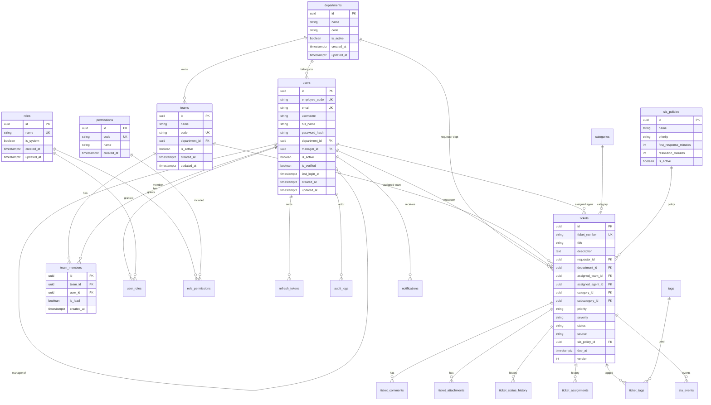

# Database

PostgreSQL is the system of record. All primary keys are UUIDs. All timestamps are `timestamptz` stored in UTC. JSONB is used only for audit payloads and similarly flexible metadata — not as a substitute for relational tables.

This document describes the **full intended schema**. Milestone 1 migrates organization, identity, RBAC, refresh tokens, and audit logs. Ticket, SLA, comment, attachment, and notification tables are added in later migrations.

## ER diagram



## Milestone 1 tables

### departments

| Column | Type | Notes |
| --- | --- | --- |
| `id` | `uuid` PK | `gen_random_uuid()` |
| `name` | `varchar(120)` NOT NULL | unique |
| `code` | `varchar(40)` NOT NULL | unique, stable machine key (`FIN`, `HR`, `IT`) |
| `description` | `text` NULL | |
| `is_active` | `boolean` NOT NULL DEFAULT true | soft disable |
| `created_at` | `timestamptz` NOT NULL | |
| `updated_at` | `timestamptz` NOT NULL | |

Seeded: Finance, HR, Operations, Engineering, Administration, Sales, IT.

### users

| Column | Type | Notes |
| --- | --- | --- |
| `id` | `uuid` PK | |
| `employee_code` | `varchar(50)` NULL | unique when not null |
| `email` | `varchar(255)` NOT NULL | unique, stored lowercase |
| `username` | `varchar(80)` NULL | unique when not null |
| `full_name` | `varchar(200)` NOT NULL | |
| `password_hash` | `varchar(255)` NOT NULL | Argon2 |
| `department_id` | `uuid` NULL FK → departments | `ON DELETE SET NULL` |
| `manager_id` | `uuid` NULL FK → users | `ON DELETE SET NULL` |
| `is_active` | `boolean` NOT NULL DEFAULT true | disable instead of delete |
| `is_verified` | `boolean` NOT NULL DEFAULT false | reserved for future email verify / SSO |
| `last_login_at` | `timestamptz` NULL | |
| `created_at` | `timestamptz` NOT NULL | |
| `updated_at` | `timestamptz` NOT NULL | |

Indexes: `email` unique, `employee_code` unique (partial), `username` unique (partial), `department_id`, `manager_id`.

### teams

IT teams belong to a department (typically IT). Names are not stored as free text on tickets later; tickets will FK to `teams.id`.

| Column | Type | Notes |
| --- | --- | --- |
| `id` | `uuid` PK | |
| `name` | `varchar(120)` NOT NULL | |
| `code` | `varchar(40)` NOT NULL | unique (`SVC`, `NET`, `INFRA`, `HW`, `BA`, `SEC`) |
| `description` | `text` NULL | |
| `department_id` | `uuid` NOT NULL FK → departments | |
| `is_active` | `boolean` NOT NULL DEFAULT true | |
| `created_at` / `updated_at` | `timestamptz` | |

Unique `(department_id, name)`.

### team_members

| Column | Type | Notes |
| --- | --- | --- |
| `id` | `uuid` PK | |
| `team_id` | `uuid` NOT NULL FK → teams | `ON DELETE CASCADE` |
| `user_id` | `uuid` NOT NULL FK → users | `ON DELETE CASCADE` |
| `is_lead` | `boolean` NOT NULL DEFAULT false | |
| `created_at` | `timestamptz` NOT NULL | |

Unique `(team_id, user_id)`. Index on `user_id` for “teams of this user”.

### roles

| Column | Type | Notes |
| --- | --- | --- |
| `id` | `uuid` PK | |
| `name` | `varchar(80)` NOT NULL unique | `Employee`, `Admin` |
| `description` | `text` NULL | |
| `is_system` | `boolean` NOT NULL DEFAULT false | system roles cannot be deleted |
| `created_at` / `updated_at` | `timestamptz` | |

### permissions

| Column | Type | Notes |
| --- | --- | --- |
| `id` | `uuid` PK | |
| `code` | `varchar(80)` NOT NULL unique | e.g. `ticket.view_own` |
| `name` | `varchar(120)` NOT NULL | |
| `description` | `text` NULL | |
| `created_at` | `timestamptz` NOT NULL | |

### role_permissions

PK `(role_id, permission_id)`. Both FKs cascade on delete of the mapping row only; deleting a system role is application-forbidden.

### user_roles

PK `(user_id, role_id)`.

### refresh_tokens

Opaque refresh tokens are stored **hashed** (SHA-256 hex). The raw token is returned once at login/refresh.

| Column | Type | Notes |
| --- | --- | --- |
| `id` | `uuid` PK | also used as token family id parent if needed |
| `user_id` | `uuid` NOT NULL FK → users | `ON DELETE CASCADE` |
| `token_hash` | `char(64)` NOT NULL unique | |
| `family_id` | `uuid` NOT NULL | rotation family |
| `expires_at` | `timestamptz` NOT NULL | |
| `revoked_at` | `timestamptz` NULL | |
| `replaced_by_id` | `uuid` NULL FK → refresh_tokens | |
| `user_agent` | `varchar(300)` NULL | |
| `ip_address` | `varchar(45)` NULL | |
| `created_at` | `timestamptz` NOT NULL | |

Indexes: `user_id`, `token_hash`, `(family_id, revoked_at)`.

Reuse of a revoked token in an active family revokes the entire family.

### audit_logs

Append-only. No update/delete API for regular users.

| Column | Type | Notes |
| --- | --- | --- |
| `id` | `uuid` PK | |
| `actor_id` | `uuid` NULL FK → users | `ON DELETE SET NULL` |
| `action` | `varchar(80)` NOT NULL | `user.created`, `role.changed`, … |
| `entity_type` | `varchar(80)` NOT NULL | |
| `entity_id` | `uuid` NOT NULL | |
| `previous_values` | `jsonb` NULL | |
| `new_values` | `jsonb` NULL | |
| `metadata` | `jsonb` NULL | request id, extra context |
| `created_at` | `timestamptz` NOT NULL | |

Indexes: `(entity_type, entity_id)`, `actor_id`, `created_at DESC`, `action`.

## Later tables (not in Milestone 1 migration)

### categories

Self-referential `parent_id`. Unique `(parent_id, name)`. Index `parent_id`.

### tags / ticket_tags

`tags.slug` unique. `ticket_tags` PK `(ticket_id, tag_id)`.

### sla_policies / sla_events

Policies keyed by `priority` for V1 (one active policy per priority). `sla_events` is an append-only timeline (`STARTED`, `PAUSED`, `RESUMED`, `FIRST_RESPONSE_MET`, `FIRST_RESPONSE_BREACHED`, `RESOLUTION_WARNING`, `RESOLUTION_BREACHED`, `COMPLETED`).

### tickets

Human number `ticket_number` (`IT-2026-000001`) is **unique, not the PK**. `version integer NOT NULL DEFAULT 1` supports optimistic concurrency on assignment and status changes.

Enums (PostgreSQL native or SQLAlchemy `Enum` stored as `varchar` with check constraints):

- `priority`: `CRITICAL`, `HIGH`, `MEDIUM`, `LOW`
- `severity`: `CRITICAL`, `HIGH`, `MEDIUM`, `LOW`
- `status`: `NEW`, `OPEN`, `ASSIGNED`, `IN_PROGRESS`, `WAITING_FOR_USER`, `WAITING_FOR_VENDOR`, `ON_HOLD`, `RESOLVED`, `CLOSED`, `CANCELLED`, `REJECTED`, `REOPENED`
- `source`: `WEB`, `EMAIL`, `API`, `ADMIN`, `MONITORING`

### Planned ticket indexes

| Index | Why |
| --- | --- |
| unique `ticket_number` | lookup by human id |
| `status` | queues and filters |
| `priority` | P1/P2 work |
| `requester_id` | employee “my tickets” |
| `assigned_agent_id` | agent my-queue |
| `assigned_team_id` | team queue |
| `department_id` | department filter |
| `category_id` | reporting / filter |
| `created_at DESC` | default list sort |
| `updated_at DESC` | recently updated |
| `due_at` | SLA / due sorting |
| `(assigned_team_id, status)` | team queue |
| `(assigned_agent_id, status)` | agent queue |
| `(department_id, status)` | department ops view |
| `(status, priority)` | triage |

Do not add more composite indexes until `EXPLAIN ANALYZE` on real list queries shows the need.

### ticket_comments

`type` in (`PUBLIC_COMMENT`, `INTERNAL_NOTE`). Employees never receive `INTERNAL_NOTE` rows from the API.

### ticket_attachments

Metadata only. Bytes live in MinIO. `storage_key` is generated server-side.

### ticket_status_history / ticket_assignments

Append-only history. Never infer past state only from the current ticket row.

### notifications

In-app inbox. Email delivery is a background job (Milestone 3).

### ticket_number_sequences

```text
(year integer PK, last_value integer NOT NULL)
```

Allocated inside the ticket-creation transaction with row lock. Avoids gaps-as-correctness issues while remaining simple.

## Connection pool

Configured on the SQLAlchemy async engine (see `app/database/session.py`):

| Setting | Default | Reason |
| --- | --- | --- |
| `pool_size` | 10 | baseline concurrent checkouts per API process |
| `max_overflow` | 20 | burst room without opening unbounded connections |
| `pool_pre_ping` | true | drop stale connections after idle/firewall timeout |
| `pool_recycle` | 1800 s | recycle before typical NAT/server idle timeouts |

One engine per process, created at startup. Never create an engine per request. Several API replicas × (pool_size + max_overflow) must stay under PostgreSQL `max_connections`. PgBouncer can be introduced later without changing application SQL.

## Conventions

- No physical delete of users or (later) tickets in normal flows.
- No comma-separated id lists.
- No department/team/category names duplicated onto tickets as text.
- Foreign keys everywhere a relationship exists.
- Alembic is the only schema migration path. `create_all` is not used in production startup.
